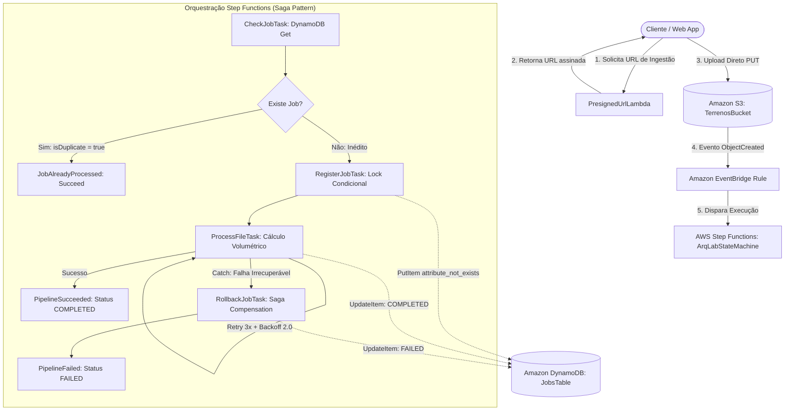

# ArqLab — Arquitetura Serverless Orientada a Eventos na AWS

[](https://github.com/brunoardel/lab-aws-cdk-architecture)
[](https://aws.amazon.com/cdk/)
[](https://www.typescriptlang.org/)
[](LICENSE)

> **Referência Técnica de Engenharia de Software e Infraestrutura em Nuvem (IaC):**  
> Pipeline assíncrono para ingestão e processamento de terrenos pesados (.dwg / .kmz) utilizando **AWS CDK v2**, **AWS Step Functions**, **Amazon DynamoDB**, **Amazon S3** e **AWS Lambda**, validado **100% localmente sem custos ou necessidade de credenciais de nuvem**.

---

## 🏛️ 1. Contexto e Problema de Negócio

Em sistemas de arquitetura e engenharia civil, arquivos de topografia e terraplanagem (como `.dwg` do AutoCAD e `.kmz` do Google Earth) possuem tamanhos que variam de **dezenas a centenas de megabytes**.

### O Gargalo da Abordagem Tradicional:
- **API Gateway Payload Limit**: O Amazon API Gateway impõe um limite estrito de payload de **10 MB**.
- **Consumo Desnecessário de Memória e Timeout**: Trafegar arquivos binários pesados por funções Lambda síncronas esgota a RAM alocada e incorre em custos excessivos de execução ociosa.
- **Falhas de Conexão no Upload**: Uploads multipart síncronos falham facilmente em conexões instáveis de clientes em canteiros de obras.

### A Solução ArqLab:
Um pipeline **desacoplado e orientado a eventos**, onde o cliente recebe uma **S3 Presigned URL** temporária com validação prévia de contrato (Zod), envia o binário diretamente ao bucket S3 com criptografia e menor privilégio, e o evento de armazenamento dispara a orquestração distribuída via **EventBridge** e **Step Functions**.

---

## 🔄 2. Diagrama da Arquitetura



---

## ⚖️ 3. Decisões de Design & Trade-offs Arquiteturais (Senior Review)

### A. S3 Presigned URL vs. API Gateway Multipart
- **Decisão:** O cliente solicita uma URL pré-assinada de 15 minutos (`expiresIn: 900`) e faz o upload diretamente no Amazon S3 via `PUT`.
- **Justificativa:** Elimina o limite rígido de 10 MB do API Gateway, zera o custo de memória RAM/tempo de execução de Lambdas atuando como "proxy de bytes" e permite aceleração de transferência e políticas de CORS nativas no S3.

### B. AWS Step Functions vs. Encadeamento Direto de Lambdas
- **Decisão:** Orquestração declarativa de estados via máquina de estados do Step Functions com políticas nativas de `Retry` e `Catch`.
- **Justificativa:** O encadeamento direto de Lambdas (ex: Lambda 1 invocando Lambda 2) cria acoplamento temporal frágil, dificulta a rastreabilidade e impede o uso do **Padrão Saga**. No Step Functions, cada transição possui visibilidade de auditoria no Workflow Studio e a compensação (*Rollback*) é garantida pelo bloco `Catch`.

### C. Idempotência At-Least-Once no DynamoDB (`attribute_not_exists`)
- **Decisão:** Uso de trava condicional no DynamoDB com Partition Key `pk = "JOB#<id>"` e `ConditionExpression: "attribute_not_exists(pk)"`.
- **Justificativa:** Sistemas orientados a eventos garantem entrega *At-Least-Once*, o que significa que o mesmo evento pode ser disparado mais de uma vez em caso de retransmissões do EventBridge. A trava atômica no DynamoDB garante que o cálculo volumétrico (pesado e custoso) nunca seja reexecutado para o mesmo job.

### D. Menor Privilégio IAM com CDK L2 Constructs
- **Decisão:** Definição tipada de políticas IAM utilizando métodos L2 nativos (`terrenosBucket.grantPut()`, `terrenosBucket.grantRead()`, `jobsTable.grantReadWriteData()`).
- **Justificativa:** Elimina erros manuais de JSON/YAML e impede o uso perigoso de `Action: "*"` e `Resource: "*"`.

---

## 🖥️ 4. Simulador Visual Interativo (Workflow Studio)

O projeto inclui um **Dashboard Visual Standalone** inspirado no AWS Management Console e no Step Functions Workflow Studio, acessível sem dependências externas:

### Como Abrir:
Basta abrir o arquivo [docs/index.html](file:///c:/Users/Bruno/Documents/Projetos/labs/lab-aws-cdk-architecture/docs/index.html) diretamente no navegador:
```bash
# Windows
start docs/index.html

# macOS
open docs/index.html

# Linux
xdg-open docs/index.html
```

### Cenários Prontos para Simulação:
1. **🟢 Simular Fluxo Feliz (Upload DWG 80MB)**: Demonstra a geração da Presigned URL, upload no S3, evento no EventBridge e execução de cada nó do Step Functions até a gravação final do cálculo de terraplanagem (`volumeCorteM3` e `volumeAterroM3`) no DynamoDB.
2. **🟠 Simular Idempotência (Evento Duplicado)**: Demonstra o nó `CheckJob` detectando a chave já existente e desviando o fluxo para `JobAlreadyProcessed`, evitando reprocessamento.
3. **🔴 Simular Falha & Rollback Saga**: Força um erro de malha geométrica corrompida em `ProcessFile`, demonstrando a tentativa de retry e o acionamento do nó compensatório `RollbackJob`, que marca o status como `FAILED` no DynamoDB.

---

## ⚡ 5. Estratégia de Testes 100% Offline (Zero Custos)

O projeto segue a filosofia **Offline-First**. Toda a infraestrutura e lógica de negócio são validadas em segundos na sua máquina:

| Camada de Teste | Ferramentas | Escopo |
| :--- | :--- | :--- |
| **Infraestrutura como Código (IaC)** | `@aws-cdk-lib/assertions`, `vitest` | Inspeciona o CloudFormation gerado pelo CDK: validação de criptografia, bloqueio público no S3, modo On-Demand e TTL no DynamoDB, retries e sagas no Step Functions e conformidade de menor privilégio IAM. |
| **Ingestão & Validação Zod** | `aws-sdk-client-mock`, `zod`, `vitest` | Testa a geração de Presigned URLs, expiração, sanitização contra *directory traversal* e rejeição de arquivos não autorizados ou maiores que 200 MB. |
| **Idempotência & Step Handlers** | `aws-sdk-client-mock`, `vitest` | Simula respostas do DynamoDB DocumentClient: trava atômica, captura de `ConditionalCheckFailedException`, fluxo sequencial feliz e compensação Saga Rollback. |

---

## 🚀 6. Guia de Execução Local

### Pré-requisitos
- **Node.js** >= 20.x
- **npm** >= 10.x
- **Docker** *(opcional, apenas para o emulador Floci)*

### Instalação
```bash
git clone https://github.com/brunoardel/lab-aws-cdk-architecture.git
cd lab-aws-cdk-architecture
npm install
```

### Comandos de Testes e Qualidade

```bash
# Executa a suíte completa de testes unitários e de infraestrutura (38 testes)
npm test

# Executa testes em modo contínuo de desenvolvimento
npm run test:watch

# Validação estrita de tipos do TypeScript sem emitir artefatos
npm run typecheck
```

### Síntese do CloudFormation com AWS CDK
```bash
# Sintetiza o template CloudFormation a partir da Stack CDK
npx cdk synth
```

---

## 🐳 7. Emulador Local Opcional (Floci)

Caso deseje subir uma réplica local dos serviços da AWS com interface Web:

```bash
# Iniciar o emulador Floci na porta 4566
docker compose up -d

# Acessar a interface Web do Floci:
# http://localhost:4566/_floci/ui

# Parar o emulador
docker compose down
```

---

## 📁 8. Estrutura do Repositório

```
lab-aws-cdk-architecture/
├── docs/
│   ├── PRD.md                       # Especificação de Requisitos do Produto
│   ├── TASKS.md                     # Backlog de tarefas do laboratório
│   ├── EXPERIMENTO_CDK_IAC.md       # Guia didático de Constructs L1/L2/L3 e Assertions
│   └── index.html                   # Simulador visual interativo (Workflow Studio)
├── infra/
│   └── arqlab-pipeline-stack.ts     # Stack do AWS CDK (S3, DynamoDB, SFN, Lambdas, IAM)
├── src/
│   ├── handlers/
│   │   ├── check-job.ts             # Consulta se o job já existe para alimentar o Choice
│   │   ├── get-presigned-url.ts     # Geração de Presigned URL com sanitização e Zod
│   │   ├── process-file.ts          # Cálculo volumétrico e conclusão no DynamoDB
│   │   ├── register-job.ts          # Trava condicional com status PROCESSING
│   │   └── rollback-job.ts          # Compensação transacional (Padrão Saga)
│   ├── schemas/
│   │   └── presigned-url.schema.ts  # Contratos Zod para validação em runtime
│   └── services/
│       └── idempotency.service.ts   # Serviço DynamoDB com trava atômica e TTL
├── test/
│   ├── setup.test.ts                # Teste de sanidade do CDK Assertions
│   ├── arqlab-pipeline-stack.test.ts# Suíte de asserções da Stack CDK
│   └── unit/
│       ├── presigned-url.test.ts    # Testes unitários do Presigner e validação Zod
│       ├── idempotency.test.ts      # Testes da trava condicional e duplicidade
│       └── step-handlers.test.ts    # Testes dos handlers do Step Functions e Saga
├── docker-compose.yml               # Emulador local leve Floci (porta 4566 + UI)
├── tsconfig.json                    # TypeScript strict com noUncheckedIndexedAccess
├── vitest.config.ts                 # Configuração do runner de testes Vitest
└── README.md                        # Documentação técnica oficial do projeto
```

---

## 📄 Licença
Distribuído sob a licença MIT. Consulte `LICENSE` para mais detalhes.
